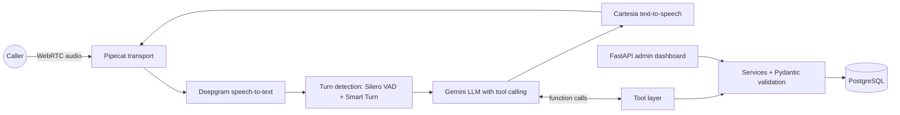
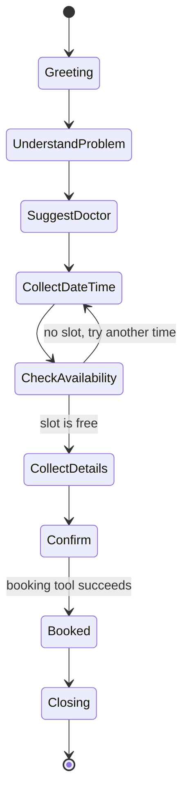

# Zaara: an AI voice receptionist for dental clinics

> Patients call, Zaara answers in natural **Hinglish**, understands the problem, suggests the right dentist, checks real availability and books the appointment. The same slot can never be booked twice. The clinic owner manages everything from a simple dashboard.

**Status: working prototype.** Tested end to end with my own test calls through the browser. Not yet connected to a phone line and not yet live in a clinic. See [Known limitations](#known-limitations) and the [Roadmap](#roadmap).

<!-- TODO: replace with your real links before publishing -->
**Demo video (2 min):** [watch here](https://lnkd.in/p/g_Cze_YD)

---

## Table of contents
1. [The problem](#the-problem)
2. [What Zaara does](#what-zaara-does)
3. [Example conversation](#example-conversation)
4. [Architecture](#architecture)
5. [How a call flows](#how-a-call-flows)
6. [How double-booking is prevented](#how-double-booking-is-prevented)
7. [The LLM's tools](#the-llms-tools)
8. [Admin dashboard](#admin-dashboard)
9. [Latency: from 30-60 seconds to a few seconds](#latency-from-30-60-seconds-to-a-few-seconds)
10. [Observability](#observability)
11. [Tech stack](#tech-stack)
12. [Project structure](#project-structure)
13. [Getting started](#getting-started)
14. [Configuration](#configuration)
15. [Testing](#testing)
16. [Security and privacy](#security-and-privacy)
17. [Known limitations](#known-limitations)
18. [Roadmap](#roadmap)
19. [Lessons learned](#lessons-learned)
20. [Vision](#vision)
21. [About the author](#about-the-author)

---

## The problem
Small clinics lose patients to the phone. The front desk is busy with someone in the chair, the clinic is closed, or the line is simply not answered, and the patient books somewhere else. Hiring more staff for every missed call is not realistic for a small clinic, and most "AI receptionists" are built for English and for other markets.

Zaara is built for the way patients in India actually talk: Hindi, English and a mix of both, often in one sentence.

## What Zaara does
- **Answers calls in Hinglish** with a consistent, feminine receptionist persona and voice.
- **Understands the dental problem** and suggests the right type of dentist (general dentist, orthodontist, endodontist, oral surgeon).
- **Checks real availability** in the database and offers nearby alternatives when a slot is taken.
- **Collects the patient's full name and phone number**, reads the number back digit by digit, and only then books.
- **Never claims a booking that did not happen.** "Your appointment is booked" is only said after the booking tool returns success.
- **Handles emergencies and limits.** Severe symptoms are sent to emergency care, medical advice is never given, and if asked, Zaara says honestly that she is an AI assistant.
- **Gives the clinic owner a dashboard** to manage doctors, see patients and track appointments live.

## Example conversation
A shortened test conversation (patient speech translated in brackets):

```text
Zaara:   Hello, mera naam Zaara hai, Smile Care Dental Clinic se. Main aapki kis tarah se help kar sakti hu?
Patient: Mere daant mein bahut dard ho raha hai.       [I have a lot of tooth pain]
Zaara:   Oh, yeh sunkar mujhe bahut dukh hua. Kya dard kab se ho raha hai?
Patient: Kal raat se.                                   [Since last night]
Zaara:   Agar aap kahein to main aapke liye hamare best doctor dhoondh du?
Patient: Haan zaroor.
         (tool call: find_relevant_doctor -> Endodontist)
Zaara:   Mere khayal se Dr. ... aapke liye best rahenge. Kya main inke saath appointment book kar du?
Patient: Haan, kal 5 baje.                              [Yes, tomorrow at 5]
         (tool call: check_appointment_availability -> available)
Zaara:   Ji, paanch baje ka slot khaali hai. Booking ke liye aapka naam bata dijiye?
...
Zaara:   Toh aapka number hai nau, ek, chaar... Sahi hai na?
Patient: Haan.
         (tool call: book_dental_appointment -> success)
Zaara:   Aapki appointment book ho gayi hai. Kya main aur kuch madad kar sakti hu?
```

## Architecture



Two separate programs share one database:

| Program | What it is | Entry point |
|---|---|---|
| **Voice agent** | Real-time conversation, built on Pipecat | `app/voice/voice_agent.py` |
| **Admin dashboard** | FastAPI server plus a single-page web UI | `app/admin/app.py` |

A change made in the dashboard (for example deactivating a doctor) is seen by the voice agent on its next call, because both read the same tables.

**Key design rule: the LLM never touches the database.** It can only call four tools. Each tool validates its input, calls a service function, and returns a structured result. The database has the final say on what is allowed.

## How a call flows
The receptionist prompt defines a small state machine, so the conversation stays on track instead of drifting:



Guardrails written into the prompt and enforced by the tools:
- **Emergency check before every state.** Severe pain with swelling, breathing trouble or heavy bleeding is directed to emergency care.
- **No medical advice.** Zaara says the doctor will examine the patient.
- **One short question at a time**, spoken in a few words, because this is a phone call.
- **Real dates.** Today's date is injected in Indian time, so "kal" and "parso" become real days and closed days (Sundays) are refused.
- **Tool-gated claims.** Doctor, slot and booking facts only come from tool results, never from the model's imagination.
- **Full name only.** If a patient gives a nickname, the full name is asked for.
- **Phone validation.** 10 digits, read back digit by digit before booking.

## How double-booking is prevented
Preventing double-booking is a database concern, not just a prompt concern, so it is enforced in layers:

1. **Pydantic validation** (`BookingRequest`) rejects malformed input before anything else runs.
2. **Service-layer booking rules** check the patient and the slot.
3. **A PostgreSQL partial unique index** has the final word:
   `UNIQUE (doctor_id, appointment_date, appointment_time) WHERE status = 'booked'`
   Even two simultaneous callers cannot book the same doctor at the same time.
4. **Cancelling frees the slot**, because the index only applies to `booked` appointments.

Patient identity is **full name plus phone number**. One phone number can hold several patients (a family sharing a phone), a patient can book on different days or times, and the same patient cannot be booked with two doctors at the same time.

## The LLM's tools
Schemas live in `app/llm/tools.py`. The model sees exactly these four:

| Tool | Purpose |
|---|---|
| `find_relevant_doctor` | Maps the patient's problem to a specialization and returns the doctor (id, name, specialization, fee). |
| `check_appointment_availability` | Checks whether one exact slot is free for a doctor. |
| `find_available_appointment_slots` | Returns nearby free slots when the requested one is taken. |
| `book_dental_appointment` | Validates, creates or finds the patient, and books. The only tool that writes. |

A thin glue layer in the voice agent makes every tool call safe for real-time audio:
- Blocking database calls run in a **worker thread** so they never freeze the audio stream.
- Every call has an **8-second timeout**.
- Exceptions are converted into clean error results (`validation_error`, `booking_error`, `internal_error`) the model knows how to speak about.
- Booking calls are **not cancelled** if the caller talks over Zaara, so a saved booking can never lose its result.
- Every call and its duration is logged.

## Admin dashboard
A FastAPI backend with a calm, single-file web UI (plain HTML, CSS and JavaScript, no build step).

| Page | What the owner can do |
|---|---|
| **Doctors** | Add and edit doctors (name, specialization, fee). Switch a doctor on or off with a toggle. A warning appears before deactivating a doctor who still has upcoming bookings. |
| **Patients** | See everyone who has booked, with search by name or phone, appointment counts and the next appointment. |
| **Appointments** | Filter by day, doctor, status and patient. Mark appointments completed or cancelled. The list refreshes automatically, so new bookings appear within seconds. |
| Call activity | Planned: every call, transcript, latency and cost. |
| Settings | Planned: clinic hours, greeting, voice and language. |

Design decisions worth knowing:
- **Doctors are deactivated, never deleted.** Past appointments reference them, and the database refuses the deletion anyway.
- **Specialization is a fixed dropdown.** The strings must match what the doctor-routing logic expects, so a typo can never make a doctor invisible to the assistant.
- **Duplicate doctors are rejected** (same name and specialization, any capitalization).
- **Everything a patient typed is shown as plain text**, never as HTML.

> **The dashboard has no login yet. Do not expose it to the internet.** Authentication is the first item on the roadmap.

## Latency: from 30-60 seconds to a few seconds
For a phone call, a slow reply is a broken product. The first version used a local model and was unusable.

| Setup | Reply time | Notes |
|---|---|---|
| Local Llama 3.2 via Ollama on my laptop | **30-60 seconds** per reply in the full agent | The first message could take about a minute. |
| Hosted Gemini, reasoning-class Flash model | about 5-6 seconds | The model "thinks" before answering, which adds seconds. |
| Hosted Gemini Flash-Lite, tuned pipeline | **about 3-5 seconds** | Measured from chat timestamps; per-stage metrics are being collected. |

The standalone benchmark in [`scripts/benchmark_ollama.py`](scripts/benchmark_ollama.py) isolates the model from the voice pipeline. On a **one-sentence** prompt, local Llama 3.2 took **2.2 s to the first word and 5.2 s in total**. The real receptionist prompt is many times longer, which explains the far worse latency inside the agent. The output was also wrong: it translated "book an appointment" as handing over a book, so the local model was both slow and weak in Hindi.

What made the difference:
1. **A fast hosted model instead of a local one.** This was the biggest win, and it also removed the long first-message delay caused by loading the model.
2. **A Flash-Lite model instead of a reasoning model.** Models that think first add seconds of silence.
3. **Database calls off the audio thread**, with timeouts, so a slow query cannot freeze the conversation.
4. **Turn detection configured once** (Silero VAD in the user aggregator, not duplicated) with Smart Turn to decide when the patient has finished speaking.
5. **Language set explicitly to Hindi** in the text-to-speech service.

These are measurements from my development laptop, not a formal benchmark.

## Observability
Today:
- Pipecat metrics and usage metrics are enabled (time to first byte per stage, token and character usage).
- Every tool call and result is logged with its duration (`TOOL CALL ->` and `TOOL RESULT <-`).
- Pipecat's logs show transcripts and turn events for debugging.

Planned: save per-call latency, token use and cost to the database, show them in the dashboard's Call activity page, and track accuracy on a fixed set of scripted test calls.

## Tech stack

| Area | Choice |
|---|---|
| Voice framework | [Pipecat](https://github.com/pipecat-ai/pipecat) (WebRTC) |
| Speech-to-text | Deepgram (`nova-3`, multilingual) |
| LLM | Google Gemini (hosted, Flash-Lite class, configurable) with function calling |
| Text-to-speech | Cartesia (Hindi) |
| Turn detection | Silero VAD and Smart Turn v3 |
| Database | PostgreSQL via `psycopg` 3 (plain SQL) |
| Validation | Pydantic |
| Admin backend | FastAPI and Uvicorn |
| Admin frontend | Plain HTML, CSS and JavaScript |
| Tooling | `uv` for dependencies, Python 3.13 |

## Project structure
```text
app/
  admin/        FastAPI admin: routes, schemas, service, errors, static UI
  agent/        TODO: describe this folder, or remove the line if unused
  core/         logging setup
  database/     connection and shared queries
  llm/          tool schemas (used by the voice agent) and a text-only chat harness
  schemas/      Pydantic models (e.g. BookingRequest)
  services/     business logic: patients, doctors, appointments, booking rules
  tools/        the functions the LLM can call
  voice/        the Pipecat voice agent and its prompt
  exceptions.py shared exception types
db/             schema.sql (tables and constraints) and seed data
scripts/        benchmark_ollama.py (latency evidence)
docs/images/    screenshots
```
Request path: **tools -> services -> database.** The LLM only ever sees the tools.

## Getting started

### Prerequisites
- Python 3.13 and [uv](https://docs.astral.sh/uv/)
- PostgreSQL
- API keys for Deepgram, Cartesia and Google AI Studio (Gemini)

### 1. Install
```bash
git clone https://github.com/BilalCodePhoenix/zaara-ai.git
cd zaara-ai
uv sync
```

### 2. Create the database
```bash
createdb dental_db
psql -d dental_db -f db/schema.sql
psql -d dental_db -f db/seed.sql   # optional: a few sample doctors
```

### 3. Configure
```bash
cp .env.example .env     # on Windows: copy .env.example .env
```
Then fill in `.env` (see [Configuration](#configuration)).

### 4. Run the admin dashboard
```bash
uv run uvicorn app.admin.app:app --port 8000
```
Open http://localhost:8000 (interactive API docs at http://localhost:8000/docs).

### 5. Run the voice agent
```bash
uv run python -m app.voice.voice_agent -t webrtc
```
Open the local URL Pipecat prints (usually http://localhost:7860), allow the microphone, and start talking. Use headphones to avoid echo.

### Optional
```bash
# Text-only chat with the same tools (no voice needed)
uv run python -m app.llm.text_chat_demo

# Local-model latency benchmark (needs Ollama running)
uv run python scripts/benchmark_ollama.py
```

## Configuration

| Variable | Used by | Purpose |
|---|---|---|
| `DATABASE_URL` | voice agent, admin | PostgreSQL connection string |
| `DEEPGRAM_API_KEY` | voice agent | Speech-to-text |
| `CARTESIA_API_KEY` | voice agent | Text-to-speech |
| `GOOGLE_API_KEY` | voice agent | Gemini LLM |
| `GEMINI_API_KEY` | text harness | `app/llm/client.py` |

Constants near the top of the voice agent file: clinic name, address, Gemini model name, Cartesia voice id and the tool timeout.

## Testing
Honest status: the project has been tested **manually** with scripted conversations, including:
- Slot requests on a closed day (Sunday) and on already booked times.
- Rejected, short or wrongly formatted phone numbers.
- Nicknames given instead of the full name.
- Patients changing their mind, asking for another doctor, or refusing every alternative.
- Out-of-scope questions, medical-advice requests and "are you a robot?".
- Several people sharing one phone number.

Booking rules were also checked with direct service-level cases (same slot refused, same patient on other days and times allowed, same time with two doctors refused, two people on one number keeping their own bookings).

An automated `pytest` suite and CI are on the [roadmap](#roadmap).

## Security and privacy
- Secrets live in `.env`, which is never committed. Use `.env.example` as the template.
- All SQL uses **parameterized queries**, and column names in dynamic updates come from an allow-list.
- The dashboard renders patient-supplied text as plain text to prevent HTML injection.
- Tool results are treated as data, not instructions.
- **Use only fake data.** Patient information is sensitive. Before using real patient data, add authentication, access control, encrypted storage, consent and call-recording disclosure, and review the requirements of India's Digital Personal Data Protection Act with proper advice.

## Known limitations
- Prototype: tested through the browser, **no phone line connected yet**.
- The admin dashboard has **no authentication**.
- Cancelling and rescheduling by voice are not implemented; callers are told to contact the clinic.
- Clinic hours and address are written into the prompt, not configurable yet.
- Doctor routing is keyword-based and returns the **first** doctor of a specialization, so a fully booked doctor is not skipped in favor of a colleague.
- Database outages currently surface as a booking error rather than a clear "system problem" message.
- Hinglish speech recognition depends on audio quality; a headset noticeably improves accuracy.
- Reliant on hosted AI services, which can be slow or return temporary "high demand" errors on free tiers.

## Roadmap
- [x] Hinglish voice agent with tool calling
- [x] Booking rules and database-enforced double-booking prevention
- [x] Admin dashboard: doctors, patients, appointments
- [ ] Admin authentication
- [ ] Call logs with latency, token and cost tracking in the dashboard
- [ ] Accuracy tracking on a fixed set of scripted calls
- [ ] Automated tests (`pytest`) and CI
- [ ] Prompt-injection hardening and rate limits per phone number
- [ ] Real phone number (telephony provider) with human fallback
- [ ] Cancel and reschedule by voice
- [ ] Settings page: clinic hours, greeting, voice, language
- [ ] Multi-clinic support
- [ ] SMS or WhatsApp confirmations and reminders
- [ ] After-hours pilot with a real clinic

## Lessons learned
- **For voice, latency is the product.** The model choice (local vs hosted, reasoning vs fast) mattered more than any amount of prompt tuning.
- **Put the rules in the database, not only in the prompt.** Prompts drift; a unique index does not.
- **A tool result is the only source of truth.** Letting the model say "booked" before the tool says so is how voice agents lie.
- **The model does not know today's date.** It will confidently invent weekdays unless the date is injected.
- **Small models are weak in Hinglish.** Gendered grammar and mixed scripts need a stronger model and explicit grammar reminders at the end of the prompt.
- **Real-time code needs defensive plumbing.** Blocking calls, timeouts and shared audio-analyzer state caused real bugs until they were isolated per session.
- **Test the unhappy paths.** Invalid numbers, closed days, nicknames and refusals found more bugs than the happy path ever did.

## Vision
A reliable front desk that speaks each patient's language, for every small clinic in India, at a price a clinic can afford: no missed calls, no double bookings, and clear visibility for the owner into what the assistant did and how well it did it.

## About the author
Built by **Bilal**, a B.Tech CS-AI graduate from Lucknow who builds agentic AI systems (LangGraph, RAG, MCP). Zaara is my first end-to-end voice project.

- GitHub: [BilalCodePhoenix](https://github.com/BilalCodePhoenix)
- LinkedIn: www.linkedin.com/in/mohd-bilal-456454257

## License
No license has been chosen yet. All rights reserved until one is added. Please contact me if you would like to reuse or pilot this project.